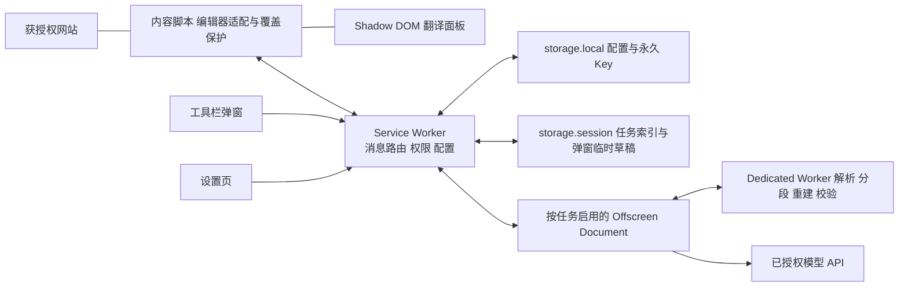
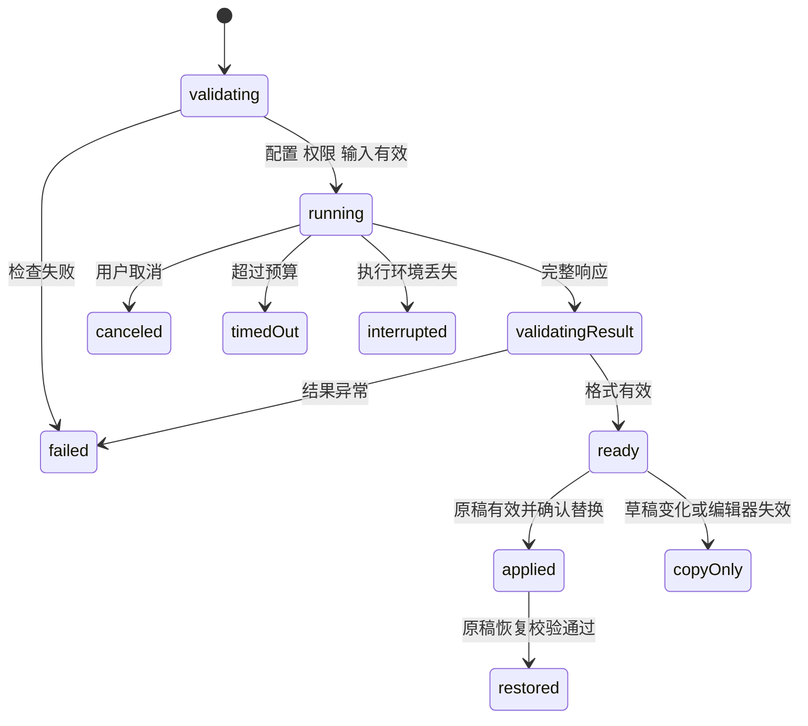

# Sayvia 技术方案

- 文档版本：v0.3
- 对应需求：[产品 PRD v0.3](./PRD.md)
- 状态：方案设计，尚未实现或完成技术验证
- 更新日期：2026-10-30
- 项目仓库：[carter-ya/sayvia](https://github.com/carter-ya/sayvia)

采用 TypeScript、WXT、React 和 Chrome Manifest V3，首版以用户自带 API Key 的纯扩展方案实现。Key 在当前设备永久保存，GitHub 优先适配，Product Hunt 专项适配后置。本文定义模块边界、数据与通信、编辑器安全回写、模型协议、任务生命周期和测试计划。

PRD 中尚未确认的用户自带 Key、自定义接口首版上线、默认预览等事项，作为本方案的实现假设，不在此自动转为已确认产品决策。

## 1 核心技术决策

| 编号 | 决策 | 原因与边界 |
| --- | --- | --- |
| D01 | 使用 WXT 管理 MV3 扩展构建，TypeScript strict 模式 | 统一后台、内容脚本、弹窗、设置页和构建产物 |
| D02 | React 用于弹窗、设置页和按需加载的翻译面板 | 复用交互组件；未触发时不加载页面翻译 UI |
| D03 | 内容脚本运行于 ISOLATED world，面板使用 Shadow DOM | 隔离扩展脚本变量与网站样式；不把样式隔离当作安全隔离 |
| D04 | Service Worker 负责权限、配置、凭证和任务调度 | 页面不能提交任意 URL 或获取 Key |
| D05 | 按任务创建 Offscreen Document，实际创建 Dedicated Worker 执行文本解析与校验，网络请求由 Offscreen Document 执行 | 避免将长请求绑定到弹窗或 Service Worker 存活时间；最后一个执行任务释放后关闭 |
| D06 | Key 和配置使用 chrome.storage.local；限制为 TRUSTED_CONTEXTS | 满足永久保存、更新保留和内容脚本隔离要求 |
| D07 | 统一 Chat Completions 文本协议，用原生 fetch 接入 | 同时支持 OpenAI、DeepSeek 和兼容服务，保留服务商能力差异 |
| D08 | 按输入来源创建格式计划，Markdown 按源区间重建，DOM 选区在提取时保留语义，纯文本不强行解析 Markdown | 防止网页代码身份在纯文本提取时丢失；具体分段与重建算法须通过 M1 真实模型验证 |
| D09 | 替换采用编辑框实例、草稿修订号和全文快照联合校验 | 防止焦点变化、编辑后撤回、DOM 替换和迟到结果覆盖草稿 |
| D10 | MVP 不建业务后端，不存储翻译历史，不自动重试模型调用 | 对应当前范围，避免隐性费用和额外数据链路 |

D05 是需在 M1 验证的设计：Offscreen Document 以真实的 WORKERS 用途创建，Worker 负责 Markdown 解析、分段及格式校验；不虚报音频播放或页面抓取用途，也不将隐藏文档作为永久后台。若实测或分发审核不适用，改为用户可见的扩展翻译页执行长任务，保留相同调度接口；不静默缩短 PRD 的 60 秒请求预算。

## 2 技术栈与依赖

| 用途 | 选择 | 使用约束 |
| --- | --- | --- |
| 扩展开发 | WXT、Vite、TypeScript、pnpm | 单包项目，不引入 monorepo；初始化时锁定经验证版本 |
| 界面 | React、CSS Modules、CSS variables | 明暗主题与设计变量共用；首版不引入大型组件库 |
| 状态 | React reducer 和模块内任务状态机 | 配置通过消息读取；不把 Key 放入 React 全局状态 |
| 运行时校验 | Zod | 校验消息、配置、模型响应和迁移后的存储结构 |
| Markdown | unified、remark-parse、remark-gfm，必要时使用底层 token 位置信息 | 解析原始位置，不使用 stringify 重写整篇文本，不转成 HTML |
| 请求 | 原生 fetch、AbortController | 非流式模型请求，统一超时、取消和响应大小限制 |
| 单元与组件测试 | Vitest、Testing Library | 优先验证格式保护、覆盖保护、协议和数据迁移 |
| 扩展端到端测试 | Playwright 自带 Chromium、持久化浏览器配置 | 加载打包后的扩展，配合本地模拟 API 和编辑器页面 |
| 静态检查 | TypeScript、ESLint、Prettier | 类型、格式与构建检查纳入后续 CI |

不将具体依赖的当前最新版本写成长期约束。正式初始化生成锁文件并记录 Node 与 pnpm 版本；每次依赖更新运行关键兼容回归。[WXT 入口文档](https://wxt.dev/guide/essentials/entrypoints)

## 3 运行架构



### 3.1 页面内容脚本

负责编辑框发现、选区捕获及 DOM 语义标注、按钮、面板、草稿修订追踪、替换和恢复。只接受脱敏配置及自己的翻译结果，不接触 Key，不自己请求模型。每个文档实例有随机 documentNonce，编辑框通过 WeakMap 绑定实例身份。

页面 DOM 本来就能被网站观察，因此不能承诺译文在页面面板中对宿主网站保密；凭证始终留在受信任扩展上下文。

### 3.2 Service Worker

同步注册事件监听器；业务处理前等待存储访问限制和迁移完成。负责校验消息来源、按标签页互斥、权限管理、读取 Key、创建执行环境、分发结果、取消与配置清理。不在全局变量中保存唯一的永久配置或唯一任务索引。

### 3.3 Offscreen Document 与 Worker

Offscreen Document 接收来自后台的内部任务，持有当前请求的临时凭证及 AbortController。Dedicated Worker 接收待处理文本，执行解析和校验；Key 不进入 Worker。网络请求只在 Offscreen Document 内执行，使用继承的主机权限。

同一扩展配置文件最多创建一个 Offscreen Document，由其中的任务表管理不同标签页；任务结束即终止对应 Worker，清除源文和 Key 引用。创建与关闭使用串行生命周期锁、执行环境代号和任务计数，避免“最后任务完成关闭”与新任务创建竞态。

### 3.4 弹窗与设置页

设置页可提交新 Key、修改与删除配置，但读取配置时只返回 hasApiKey，不把已有 Key 回填到表单。弹窗展示脱敏配置，支持页面操作和手动粘贴翻译。所有远程脚本、动态下载执行代码和生产环境调试通道均不进入发布包。

## 4 项目结构

建议在现有项目中采用下列结构；本次只交付设计文档，不创建业务代码。

```text
sayvia/
├── docs/
│   ├── PRD.md
│   └── TECHNICAL_DESIGN.md
├── entrypoints/
│   ├── background.ts
│   ├── translator.content/
│   │   └── index.ts
│   ├── popup/
│   │   ├── index.html
│   │   └── main.tsx
│   ├── options/
│   │   ├── index.html
│   │   └── main.tsx
│   └── offscreen/
│       ├── index.html
│       └── main.ts
├── src/
│   ├── adapters/
│   │   ├── types.ts
│   │   ├── generic-text.ts
│   │   ├── dom-selection.ts
│   │   └── github.ts
│   ├── background/
│   │   ├── router.ts
│   │   ├── task-broker.ts
│   │   ├── permissions.ts
│   │   └── executor-host.ts
│   ├── executor/
│   │   ├── task-runner.ts
│   │   └── translation.worker.ts
│   ├── core/
│   │   ├── task-machine.ts
│   │   ├── translation-plan.ts
│   │   ├── format-validator.ts
│   │   └── prompt.ts
│   ├── providers/
│   │   ├── types.ts
│   │   ├── chat-completions.ts
│   │   └── presets.ts
│   ├── storage/
│   │   ├── repository.ts
│   │   ├── schema.ts
│   │   └── migrations.ts
│   ├── shared/
│   │   ├── messages.ts
│   │   ├── errors.ts
│   │   └── limits.ts
│   └── ui/
│       ├── components/
│       ├── panel/
│       └── styles/
├── tests/
│   ├── unit/
│   ├── integration/
│   ├── e2e/
│   └── fixtures/
├── public/
│   └── icons/
├── wxt.config.ts
└── package.json
```

构建时验证实际输出包含本地 Offscreen HTML 和独立 Worker 文件；不依赖运行时生成 Blob 脚本，避免额外放宽脚本 CSP。

## 5 权限与注入

### 5.1 权限清单

| 配置 | 内容 | 用途 |
| --- | --- | --- |
| permissions | storage、activeTab、scripting、contextMenus、offscreen、clipboardWrite | 本地保存、当前页触发、动态注入、右键翻译、任务执行及复制 |
| optional_host_permissions | https://*/* | 运行时按用户选择申请单个网站或 API 主机，不一次性授予全部 HTTPS 网站 |
| optional_host_permissions | http://localhost/*、http://127.0.0.1/* | 支持明确启用的本地模型服务 |
| commands | translate-selection、translate-editor | 右键与快捷键之外的固定入口 |
| incognito | not_allowed | MVP 不处理无痕上下文及跨配置文件状态 |
| minimum_chrome_version | 116 | 所用 runtime.getContexts 的 API 下限；实际发布仍按 PRD 验证当时稳定版与前一主版本 |

不申请 cookies、webRequest、debugger、unlimitedStorage 或读取全部标签页敏感信息的 tabs 权限。API 下限不等同于承诺支持自 Chrome 116 起的所有版本。

### 5.2 授权流程

网站操作可先使用 activeTab 的临时授权；用户希望持续显示翻译按钮时，在弹窗明确开启该网站，并请求准确主机的可选权限。API 域名授权在“保存并测试”点击事件中申请，不能等异步网络工作结束后再依赖同一次用户手势。

Chrome 主机权限不能作为精确端口、URL 路径或业务用途的边界。后台另存 allowedSites 和已保存服务地址，分别限制脚本注入和网络请求。给某 API 主机授权不代表允许注入该主机网页。[Chrome 权限文档](https://developer.chrome.com/docs/extensions/reference/api/permissions)

### 5.3 动态内容脚本

持续授权的网站通过 scripting.registerContentScripts 注册 ISOLATED world 脚本；已打开的当前文档通过 executeScript 补注入。WXT 内容入口设置为只构建、不自动为所有网站生成静态匹配；初始化时核对该版本的 include/exclude 选项和最终 manifest。

脚本使用文档级单例标记防止重复初始化，仅注入主 frame。撤销权限时取消对应任务、注销脚本并尝试通知当前文档销毁 UI；页面脚本自行处理扩展上下文失效。[Chrome scripting 文档](https://developer.chrome.com/docs/extensions/reference/api/scripting)

### 5.4 扩展页面策略

发布包脚本与 Worker 只从扩展自身加载；禁用 eval、内联脚本、远程脚本。connect-src 允许 HTTPS 及上述本地 HTTP 地址，但真实请求仍必须通过保存地址和主机权限双重校验。MVP 不开放 externally_connectable，不把设置页、Offscreen 页或执行器声明为 web_accessible_resources。

## 6 永久存储与数据模型

### 6.1 数据分区

| 位置 | 数据 | 生命周期 |
| --- | --- | --- |
| storage.local | 版本化配置、每份配置的 API Key、默认模型、语言和站点偏好 | 不设置自动过期；正常重启和更新保留 |
| storage.session | 无正文的任务索引、内部执行环境代号、弹窗手动输入及结果 | 浏览器会话内，标签页关闭或用户清除时删除；不用于保存 Key |
| 内容脚本内存 | 编辑框引用、全文快照、选区、译文、一步恢复记录 | 当前文档会话；刷新、跳转或上下文失效后释放 |
| Offscreen 内存 | 正在执行的源文、格式计划、临时 Key、请求与待交付结果 | 任务完成并交付或取消后释放 |
| 日志 | 允许列举的错误码和模块名 | 无 Key、原文、译文、私有 URL、原始 API 错误响应 |

页面任务正文不写入 session；弹窗手动输入是单独的临时草稿区，以目标标签页绑定，防止弹窗意外关闭丢失已输入内容。关闭弹窗不启动新请求，重新打开可读取该标签页的任务状态或结果。显式放弃、关闭目标标签页、清除数据时删除；重新启动浏览器不恢复任务。

### 6.2 存储结构

```ts
type ProviderKind = 'openai' | 'deepseek' | 'openai-compatible';

interface ProviderConfig {
  id: string;
  revision: number;
  name: string;
  kind: ProviderKind;
  protocol: 'chat-completions';
  baseUrl: string;
  model: string;
  secretRef: string;
  testedRevision?: number;
  testedAt?: string;
}

interface LocalStateV1 {
  schemaVersion: 1;
  revision: number;
  providers: Record<string, ProviderConfig>;
  secrets: Record<string, { apiKey: string }>;
  preferences: {
    defaultProviderId?: string;
    readTarget: string;
    writeTarget: string;
    quickReplace: boolean;
    theme: 'system' | 'light' | 'dark';
  };
  allowedSites: string[];
}
```

使用一个根配置项实现一次读改写，所有变更经后台串行队列处理并增加 revision。配置与 Key 分字段是代码访问边界，不代表存储本身加密。前端配置投影去掉 secrets、secretRef，增加 hasApiKey。

更新 Key 使用“保留／替换／删除”的明确操作，空输入不代表清除已有 Key；地址、模型或 Key 改变后增加配置 revision，并清空旧的测试有效状态。

### 6.3 访问隔离与初始化

首次存储任何凭证前，先完成 chrome.storage.local.setAccessLevel({ accessLevel: 'TRUSTED_CONTEXTS' })。storage.session 也保持仅可信扩展上下文可读。业务处理统一等待 ready Promise，初始化失败时拒绝读写和翻译，不回退到网页 localStorage。[Chrome Storage 文档](https://developer.chrome.com/docs/extensions/reference/api/storage)

不使用“密钥与密文一起存在扩展中”的方式宣称加密安全。MVP 采用受限本机存储；如未来要求操作系统钥匙串，需另行引入本地原生组件。

### 6.4 更新与迁移

onInstalled 中只在缺少数据时写入默认值；更新不得执行 storage.clear。迁移读取旧结构、在内存转换、校验完整性，再一次写入新根对象；失败保留旧数据并阻止危险操作。启动按 schemaVersion 判断是否需要补做迁移，不能仅依赖更新事件。

开发与升级测试使用相同扩展 ID 和浏览器配置文件；换 ID 的重新加载不属于可保留旧数据的正常更新。删除配置会取消其活动任务并移除对应 Key，清除全部数据同时清理执行器、session 与页面会话。

## 7 类型化消息与任务所有权

### 7.1 消息边界

| 来源 | 可调用操作 |
| --- | --- |
| 内容脚本 | 获取脱敏偏好、开始本标签页任务、取消或查询自己的任务 |
| 弹窗 | 读取脱敏配置、当前页操作、手动输入任务、用户手势下申请权限 |
| 设置页 | 保存与删除配置、提交新 Key、测试连接、清除数据 |
| 后台 | 下发内部执行任务、取消任务，向准确文档交付结果 |
| Offscreen Document | 回报执行状态、结果和取消确认，不可修改模型配置 |

所有消息包含 protocolVersion、type 和 requestId，通过 Zod 做运行时校验。未知类型、过大消息与非白名单字段拒绝处理。

内容脚本请求只携带来源明确的文本、必要的选区语义标注、目标语言、模式和编辑器会话标识；不传原始 HTML、DOM 节点、事件或页面隐藏属性，不接受请求地址、Header、Key 或由调用方指定的其他标签页。后台从 sender.tab.id、frameId、documentId 建立路由；documentNonce 用于本地会话关联，不能代替浏览器提供的来源字段。

内部分发携带随机执行令牌与 executorEpoch，后台与 Offscreen 验证扩展来源和预期上下文。内容脚本的 sender 具有网页文档来源，不能仅靠声称 target=offscreen 获取内部执行权限。各上下文实际 sender 字段在 M1 验证；来源不明时拒绝处理。

页面按钮只响应可信用户输入事件；不因网站脚本调用 click、dispatchEvent 或 window.postMessage 发起付费请求。右键与快捷键由 Chrome 扩展事件进入同一任务入口。已有任务的恢复查询只查询状态，不视为重新授权调用模型。

### 7.2 请求契约

```ts
interface TextSpan {
  start: number;
  end: number;
}

type SourceInput =
  | { kind: 'markdown'; text: string }
  | { kind: 'plain-text'; text: string }
  | {
      kind: 'dom-selection';
      text: string;
      protectedRanges: Array<TextSpan & {
        kind: 'inline-code' | 'code-block' | 'url' | 'mention' | 'reference';
      }>;
      marks: Array<TextSpan & {
        kind: 'link-label' | 'paragraph' | 'line-break';
      }>;
    };

interface StartTranslation {
  protocolVersion: 1;
  type: 'translation.start';
  requestId: string;
  payload: {
    clientTaskId: string;
    documentNonce: string;
    editorSessionId?: string;
    sourceRevision?: number;
    mode: 'read' | 'write' | 'manual';
    source: SourceInput;
    sourceLanguage: 'auto' | string;
    targetLanguage: string;
    scope: 'selection' | 'full';
  };
}

interface TaskRoute {
  taskId: string;
  tabId: number;
  frameId: number;
  documentId?: string;
  documentNonce: string;
  executorEpoch: string;
  providerId: string;
  providerRevision: number;
  startedAt: number;
  deadlineAt: number;
}
```

SourceInput 的 text 是用于本次翻译的规范源串，所有区间都是该串的 UTF-16 半开区间；不是 Unicode 字符计数或序列化后另一个字符串的偏移。后台校验区间边界和类型；保护区间彼此不得重叠，结构 marks 允许按第 9 节规则与保护区间重叠；越界或不符合规则的冲突直接拒绝。来源类型由入口决定：网页阅读用 dom-selection，已适配 Markdown 评论框用 markdown，手动输入及普通文本框默认 plain-text，不由模型猜测。

taskId 由后台生成。同一个客户端请求编号重复提交时，返回原任务状态，不重复调用模型。模型响应不得直接指示页面执行操作；替换决策始终留在原内容脚本。

### 7.3 通信方式

短命令使用 runtime.sendMessage，立即返回接受或拒绝，不让一次消息等待完整模型请求。进度和结果通过独立事件交付，内容脚本接收使用定位到原 documentId 的 tabs.sendMessage；浏览器字段不可用时同时验证 frame 和 documentNonce。

为兼容不同版本，异步消息监听器使用明确的 return true 和 sendResponse 适配，不依赖所有浏览器已支持 Promise 监听器。长连接只用于可恢复订阅，不当作后台永久存活的保证。[Chrome 消息文档](https://developer.chrome.com/docs/extensions/develop/concepts/messaging)

## 8 编辑器适配与安全替换

### 8.1 适配接口

```ts
interface EditorSnapshot {
  editorSessionId: string;
  documentNonce: string;
  revision: number;
  fullText: string;
  range: { start: number; end: number };
  scope: 'selection' | 'full';
}

interface EditorAdapter {
  id: string;
  detect(element: Element): boolean;
  capabilities(element: Element): {
    read: boolean;
    replace: boolean;
    restore: boolean;
  };
  capture(element: Element): EditorSnapshot;
  validate(snapshot: EditorSnapshot): { ok: boolean; reason?: string };
  apply(snapshot: EditorSnapshot, translatedText: string): ApplyResult;
  restore(record: RestoreRecord): ApplyResult;
}
```

DOM 节点通过本地 WeakMap 查找，不序列化到消息，不通过“再找当前焦点”定位替换对象。textarea 和 input 使用 UTF-16 selectionStart/End 偏移；12,000 字符输入限制另按 Unicode code point 计数，避免把两种索引混用。

### 8.2 首版适配策略

GitHub 适配优先于通用适配。GitHub 仅对经验证的 Issue／PR 常规纯文本评论框开放完整能力；Discussions 独立记录验证结果。通用适配限制为可见、可编辑的 textarea 与 text/search input，排除 disabled、readonly、密码、支付字段及其他敏感标记。

富文本、代码编辑器和跨域 iframe 仅预览与复制。不根据相似 DOM 结构猜测支持。GitHub 具体选择器和站点事件在 M1 实页验证后落地，不在本方案虚构稳定私有 API。

### 8.3 捕获与失效

用户触发时记录源全文、源选区、节点身份、修订号和文档地址。用 input、change、composition 事件跟踪变化；修改后再撤回也增加修订号。存在 IME 组合输入时等待其完成再捕获，不在组合期间替换。

替换前同步检查：原节点仍连接到相同文档；路由与任务仍有效；修订号未变；当前全文逐字等于快照；范围有效且候选译文格式通过校验。切换焦点不改变绑定对象；使用捕获的源区间，不能使用点击面板后产生的新 selection。

对无事件的脚本赋值，全文比较可发现当前差异，但标准 DOM 无法证明所有“脚本改动又改回”的中间历史。MVP 对用户实际输入保证单调修订追踪；对无法验证的站点行为降低为复制能力，不用侵入式全局 setter 劫持扩大兼容承诺。

### 8.4 写入与站点状态同步

用原生文本控件 setter 或经验证的 setRangeText 写入，派发对应 input 事件，按适配要求处理 change。读取回写结果，并在后续站点更新周期检查是否被框架回滚。选区替换通过“前缀 + 译文 + 后缀”构造预期全文。

本次写入使用局部事务标记区分自身派发的 input 与外部输入，仍增加草稿修订号，并在确认写入成功后建立恢复记录的新基线；不因自身事件误判为用户修改，也不能屏蔽其后发生的真实输入。

合成事件不能被视为真实用户输入，也不能保证所有受控组件接受。GitHub 必须通过“网站读取到的新正文”验证；测试环境检查实际提交载荷，真实站点由测试者自行提交到专用测试内容，不自动发布。

写入失败时只在当前内容仍可确认属于本次写入的条件下恢复快照，不覆盖竞争写入。将适配能力降级，保留译文供复制。一步恢复也使用全文和修订校验，不依赖浏览器原生撤销栈。

### 8.5 草稿与恢复会话

每个编辑框保存最近一次成功写入前全文、写入后全文和写入后修订号。之后发生任何用户修改即取消直接恢复资格，提供复制此前原文。再次成功替换覆盖原恢复记录。页面关闭或刷新后释放，不永久保存。

MutationObserver 只用于编辑框发现、节点移除及容器变化，不能用它监听 textarea.value 的所有变化。focusin 采用事件委托，动态发现做合并处理，翻译按钮通过 WeakMap 去重。SPA 地址变化、pagehide、扩展上下文失效时使旧任务失效并释放资源。

## 9 翻译计划与格式保护

### 9.1 按输入来源创建格式计划

三类 SourceInput 先经各自的提取器，再转换为公共 TranslationPlan；不能先丢弃网页结构，再试图通过 Markdown 解析恢复。

| 来源 | 提取与保护 | 输出处理 |
| --- | --- | --- |
| markdown | 解析 Markdown／GFM 的原始位置，保护代码、URL、链接目标、用户提及、引用和结构标记 | 按原始区间重建 Markdown，不全文 stringify |
| dom-selection | 在原 DOM 选区中识别 code、pre、链接标签和段落，形成规范文本及语义区间 | 按语义区间重建文本译文，不回写 DOM，不将模型输出解释为 HTML |
| plain-text | 保留换行及可识别的 URL、用户提及、引用；不把普通尖括号、缩进等自动解释为 Markdown 或 HTML | 输出纯文本；不承诺恢复粘贴前已丢失的网页代码身份 |

Markdown 的自然语言链接标签和图片替代文字可翻译；原始换行、列表前缀和转义序列保护。源文嵌入的 HTML 整段保留，不解析或执行。代码／URL 等保护规则在各输入模式适用，但不能把代码外的普通英文 timeout 一概认作代码。

### 9.2 网页选区捕获

内容脚本在右键菜单弹出前的 contextmenu 事件或快捷键处理时捕获 Range 及文本快照，避免打开面板后焦点变化丢失选区。第一次按需注入而此前没有快照时，尝试读取仍有效的页面 Range；若只有 Chrome 菜单提供的 selectionText 而没有可验证结构，则提示重新选择，不悄悄按纯文本降低保护保证。

遍历 Range 实际覆盖的文本节点，裁剪首尾边界，只提取用户选中范围；同时检查原节点的 code／pre 等祖先，保证选区完全落在一个代码节点内部或只选中其中一部分时，仍能标出代码身份。Range.cloneContents 可辅助处理跨节点边界，但不能单独替代原节点祖先检查。Selection.toString 只提供文本，不能作为语义来源。[Selection 文档](https://developer.mozilla.org/en-US/docs/Web/API/Selection/toString)、[Range 文档](https://developer.mozilla.org/en-US/docs/Web/API/Range/cloneContents)

同一次提取同步生成规范文本、换行和 UTF-16 区间映射；不先独立规范化字符串再套用旧偏移。重叠的代码范围按较外层语义合并为不冲突保护区间，链接标签标记可以与代码标记并存，此时代码保护优先。只标记链接可见标签，不读取或上传 href、事件、样式、整页 HTML 或选区外正文；原网页链接完全不改动。

提取忽略脚本、样式、模板和敏感表单内容，不把克隆节点插入文档或触发资源加载。提取出的元数据属于不可信输入，后台与 Worker 仍校验边界；选区或文档已失效时要求重新选择。

### 9.3 单次请求与返回格式

公共 TranslationPlan 包含输入来源、规范源串、可翻译区间、保护区间和必要结构标记。可翻译片段包含 id、原始范围及文本。纯受保护内容不请求模型；普通阅读文本中的代码片段原样拼回，其余自然语言仍应翻译。

按片段返回 JSON 是当前候选算法，不是已经验证的质量保证。一个用户任务只发送一次模型请求，请求以 JSON 数据描述有序片段，固定指令要求返回同 ID 的翻译片段数组，不依赖服务商都支持 response_format。可翻译原文以 user 数据消息发送，与固定高优先级指令分开；不赋予源文本工具或控制权限。

模型看到整个选中范围内可翻译片段及顺序，不上传相邻评论或仓库上下文。保护片段可用不含敏感正文的占位标记表达相邻关系，不发往模型的代码与链接仍由本地计划保留。

严格解析结果：ID 集合和顺序须一致，无重复、无遗漏、文本类型正确、无额外控制指令。未知 JSON 结构或混入解释不自动猜测修复，不额外调用模型修复。

### 9.4 重建与二次校验

使用原文切片与翻译片段重建全文，按输入来源检查：Markdown 对新增结构字符做必要转义并复查块结构、链接目标与保护片段；DOM 阅读及纯文本核对语义保护片段和换行，不再作为 Markdown 重解析。网页阅读模式的结果始终只用于预览和复制。空响应、截断、拒绝或保护内容变化均返回可理解的错误，不启用替换。

片段过于碎小、影响自然语序或无法可靠重建时，不把格式校验通过视为算法可用。M1 应先调整片段粒度，必要时采用段落级保护占位方案，再以同组真实模型样例验证；调整不能削弱原文保护或引入自动付费修复。

用户在预览中编辑译文后，复制使用当前内容；每次替换前重新校验编辑后的完整候选文本。用户刻意修改代码或链接会使保护校验不通过，可复制手动使用，不静默放宽校验。

格式校验只保证结构，不证明语义正确。否定、条件、数字和承诺是否保持仍由 PRD 的固定质量样例人工评审。

## 10 模型接口与地址规范

### 10.1 服务商与协议分离

ProviderPreset 定义默认 Base URL、协议和经测试的模型能力；ChatCompletionsAdapter 定义请求、响应与错误映射。新增服务商优先增加 preset，新增协议再实现 adapter。

内置 OpenAI Base URL 为 https://api.openai.com/v1，DeepSeek 为 https://api.deepseek.com。模型名称允许手动填写，预设以实际联调验证为准，不通过型号字符串猜测接口能力。

OpenAI 官方对新应用推荐 Responses，但本版为符合 PRD 的兼容接口范围先使用 Chat Completions；Responses 单独作为后续协议实现，不声称两者响应结构相同。[OpenAI Chat Completions 文档](https://developers.openai.com/api/reference/resources/chat/subresources/completions/methods/create)

### 10.2 Base URL 与请求地址

仅接受有效绝对 URL，不允许 userinfo、查询参数和 fragment。保留 Base URL 中已有的路径前缀，去掉尾部斜杠后追加 /chat/completions；不使用会意外清除前缀的根路径拼接。检测已填写完整 /chat/completions 的输入并提示纠正，避免双重拼接。

| Base URL | 最终地址 |
| --- | --- |
| https://api.openai.com/v1 | https://api.openai.com/v1/chat/completions |
| https://api.deepseek.com | https://api.deepseek.com/chat/completions |
| https://gateway.example/api/v1 | https://gateway.example/api/v1/chat/completions |
| http://localhost:11434/v1 | http://localhost:11434/v1/chat/completions |

远程仅 HTTPS；HTTP 仅支持明确选择的 localhost 和 127.0.0.1，本版不默认支持 IPv6 回环。设置页展示最终地址，后台保存规范化值，执行器只接受后台确认过的固定地址。

### 10.3 请求约束

使用 POST，Authorization: Bearer，Content-Type: application/json，credentials: omit，cache: no-store，redirect: error，referrerPolicy: no-referrer，stream: false。拒绝所有 HTTP 重定向，避免凭证被带到未经配置的地址。

通用请求仅发送 model、messages、stream 等必需字段。temperature、输出 token 参数、推理开关等由经验证的 preset 决定；不跨模型强制传递不支持的参数，不因参数错误自动发第二次请求。用户自定义接口必须能返回标准文本 content 及可识别的完成状态。[DeepSeek 调用文档](https://api-docs.deepseek.com/en/)

### 10.4 响应限制与错误

要求 HTTP 成功、JSON 可解析、choices[0].message.content 为非空文本且 finish_reason 为正常结束。length、content_filter、tool_calls、缺失完成状态或非文本内容均不授予替换资格；不把 reasoning_content 当译文。

响应体上限初定 1 MiB，通过读取字节流累计限制，超限立即取消；这是网络读取限制，不代表向用户流式展示。总执行预算 60 秒，从执行器接纳开始覆盖本地处理、请求、解析和校验；本机等待权限的时间不计入且不持有请求。

错误码包括 CONFIG_REQUIRED、PERMISSION_DENIED、AUTH_FAILED、RATE_LIMITED、QUOTA_EXCEEDED、MODEL_UNAVAILABLE、NETWORK_ERROR、TIMEOUT、UNSUPPORTED_RESPONSE、FORMAT_INVALID、SOURCE_CHANGED、CONTEXT_LOST、CANCELED。未知 HTTP 错误不输出完整原始响应；服务端返回文本可能包含源内容或凭证。

“测试连接”使用固定公开短句，复用相同请求和格式校验路径，只在其配置 revision 未变时标为可用。测试和正式翻译都不自动重试，不自动切换服务商。

## 11 任务状态与生命周期

### 11.1 状态机



传输状态与应用资格分别保存。输入变化可以在请求仍 running 时将 canApply 永久设为 false；即使请求随后成功，结果也只可复制。用户编辑候选译文时重算格式有效性，但不能重新激活已经失效的源快照。

### 11.2 并发与所有权

后台对真实 tabId 实行互斥，包括该标签页关联的弹窗手动翻译。同一标签页已有运行任务时立即返回 TASK_BUSY，不自动替换任务。不同标签页可并行；首版同时执行上限暂定 4，超过后提示稍后重试，不形成会隐藏累积费用的队列。连接测试单独限为一次。

创建任务先写入无正文的路由与状态索引，再派发执行器。执行器以 taskId 去重，取消墓碑覆盖尚未到达的 START；ACK 丢失后先查询状态，不能重新发起模型请求。已结束任务短期保留去重标记，随后清理。

### 11.3 Service Worker 重启

Chrome 后台可能空闲终止，且长时间等待 fetch 响应也受生命周期限制；仅打开 Port 不等于永久保活。[Chrome 后台生命周期](https://developer.chrome.com/docs/extensions/develop/concepts/service-workers/lifecycle)

因此 60 秒网络请求由受控 Offscreen 上下文执行。其存在不等于绝对不会被浏览器回收；执行器丢失时失败关闭，不自动重放。

后台重启后读取 session 中任务路由，通过 runtime.getContexts 找到唯一执行环境，再查询其 taskId 状态。仅重新绑定现有任务或交付已经完成的结果；任务已不存在则标记 interrupted。结果事件和恢复查询并发时，以 taskId 和最终状态去重。

页面任务结果交付前，使用原 tab、documentId 与 nonce 再次确认文档；文档已消失即丢弃。恢复握手只恢复结果投递，不恢复快速自动替换资格，重连后的译文统一先预览。源正文及 Key 无须为了恢复后台而写入 session。

### 11.4 取消与资源清理

页面刷新、标签页关闭、权限撤销、配置删除或清除数据都会取消关联活动任务。用户点击取消后，界面立即进入取消状态；后台发送取消到执行器，AbortController 终止读取并终止任务 Worker。迟到结果按任务终态丢弃。

执行器把待交付结果暂留内存，收到接收确认后删除；目标不存在或超出短期交付期限时也删除。页面任务由原文档确认收到；弹窗手动任务须先写入其受限 session 草稿区，再确认交付，不能因弹窗关闭而过早丢弃结果。执行中的任务有独立 deadline，完成结果暂存不超过 30 秒。配置修改不把新 Key 混入既有任务；既有任务完成仍显示其原模型快照，配置删除则取消。

所有任务释放后关闭 Offscreen Document。空闲时无周期轮询、无常驻 Worker。Offscreen 的 WORKERS 用途和仅 runtime 扩展 API 可用的限制，以官方说明为边界。[Chrome Offscreen 文档](https://developer.chrome.com/docs/extensions/reference/api/offscreen)

## 12 页面面板与交互实现

内容脚本初始只安装必要监听器，首次触发再加载 React 面板。Shadow Root 内局部 reset，关键尺寸用 px 或组件变量，避免网站根 rem 值影响；主题使用 CSS variables 与 prefers-color-scheme。WXT 提供内容脚本上下文清理和 Shadow Root UI 工具。[WXT 内容脚本文档](https://wxt.dev/guide/essentials/content-scripts.html)

面板使用纯文本原文区和可编辑译文 textarea，不以 innerHTML 渲染模型结果。模型与目标语言切换创建新任务，不修改正在执行任务。清晰区分复制、替换选区和替换全文；只在能力与校验均有效时显示可用替换操作。

关闭按钮和切换任务检查未应用的译文编辑；点击网页空白不关闭。Escape 也遵守未保存确认。提供可读按钮名称、合理的键盘焦点顺序，关闭后回到原编辑框或触发入口。

复制由实际用户点击触发 navigator.clipboard.writeText，使用当前译文编辑值；失败时保留文本并提示手动选择。获 clipboardWrite 权限也不能假设所有焦点状态下复制都成功。

快速替换只有任务未恢复重连、源快照有效、IME 已结束且格式检查通过时执行，随后显示恢复入口。页面面板不包含凭证设置字段，所有凭证输入只在受信任设置页。

## 13 测试与验收映射

### 13.1 测试层次

| 层次 | 关键测试 |
| --- | --- |
| 单元 | URL 前缀拼接、协议响应与 finish_reason、格式区间重建、保护对象、Unicode 长度、修订状态、配置迁移 |
| 适配集成 | 原生 textarea、受控输入框、选区、IME、input 事件同步、DOM 替换、编辑后撤回、恢复冲突；网页阅读中部分代码、跨链接与段落选区的语义映射 |
| 扩展集成 | 权限拒绝与撤销、来源校验、内容脚本无法读取存储、Offscreen 实际 Worker、后台重启和取消竞态 |
| 端到端 | 构建产物加载，配置、选中文字、预览、复制、替换、恢复、受限页面手动输入 |
| 人工实站 | GitHub Issue、PR、Discussions 逐项验证，SPA 导航和页面重渲染，核对真实提交状态 |
| 模型质量 | M1 用每款 12 条固定真实样例验证算法与耗时；M3 扩充到至少 30 条，按 PRD 验证发布质量 |
| 更新保留 | 同 ID、同浏览器配置，重启和 vN 到 vN+1 升级后配置及 Key 可用 |

### 13.2 关键异常用例

模拟 API 提供：立即成功、35 秒后才返回头、60 秒超时、429、鉴权失败、额度不足、空文本、截断、超大体积、无效 JSON、缺少片段及跨域重定向。测试密钥使用虚假测试值，不录制真实凭证或用户私有草稿。

必须覆盖 START 与 CANCEL 乱序、结果与取消同时到达、后台在请求中及结果交付前重启、Offscreen 被关闭、两标签页竞争创建执行环境、最后任务完成时新任务加入。上述测试不依赖 DevTools 保持后台存活。

本地受控页面捕获用户手动提交后的正文，不让扩展触发提交。真实 GitHub 只在专用测试内容中由测试者自行操作，测试自动化不向公共讨论发布。

### 13.3 PRD 验收映射

| PRD 场景 | 对应模块与验证 |
| --- | --- |
| A01、A02 | 配置仓库、连接测试、三个服务类型 |
| A03、A14 | TranslationPlan、格式验证、输入限制与不可信文本展示 |
| A04、A06、A07、A08、A11、A18 | EditorAdapter、修订号、文档身份、恢复记录、真实提交状态 |
| A05、A17 | 复制、焦点、键盘与主题 |
| A09 | 自动替换资格与恢复重连降级 |
| A10、A13、A15、A20 | DOM 选区语义提取、部分代码和跨链接保护、权限管理、复制回退与手动输入 |
| A12 | 请求预算、取消、迟到结果、执行环境恢复 |
| A16、A19 | 持久配置、删除清理与真实升级保留 |

Playwright 使用其自带 Chromium 和 launchPersistentContext 加载扩展；不假设系统 Chrome 的侧加载命令行标记仍可用。发布时另做 PRD 要求的真实 Chrome 版本兼容检查。[Playwright 扩展测试文档](https://playwright.dev/docs/chrome-extensions)

## 14 实施阶段与退出条件

详细实施步骤、分支依赖、每层范围、验证方法及 review 重点见[实施计划与 PR Stack](./IMPLEMENTATION_PLAN.md)。S00 至 S12 是计划层号，不是 GitHub PR 号码；后续 PR 在实际开发时逐层创建。

| 阶段 | 实施层 | 阶段门槛 |
| --- | --- | --- |
| 文档与托管 | S00 | 正确提交身份、远程仓库与文档基线 |
| M1 技术验证 | S01 至 S07 | S05 提前开展真实算法验证，S07 完成下述全部 M1 退出条件 |
| M2 完整体验 | S08 至 S10 | M1 通过后开始，完成全部首版功能 |
| M3 发布准备 | S11 至 S12 | 系统回归、完整质量评审与可用版本包 |

每层同步引入必要测试，不把格式、草稿或凭证保护推迟到最后。未合并依赖作为下一层 PR 的 base，依赖合并后重新核对 diff；合并与重排操作遵循实施计划。

### M1 验证关键边界

先建立最小 WXT 构建、权限与存储封装、GitHub 评论框及 DOM 选区提取样例、真实翻译最小链路和模拟 API。模拟 API 验证异常与生命周期；实际模型验证翻译算法，两者不能替代。必须验证：

1. GitHub Issue／PR 全文与选区写入进入网站实际提交状态，草稿修改后禁止应用。
2. storage.local 在内容脚本侧不可读，扩展重启与正常更新不丢 Key。
3. Offscreen 以 WORKERS 创建并实际创建本地 Worker；模型 fetch 在其文档内获得对应域名权限且不受 Service Worker 的 30 秒等待头限制。
4. 35 秒延迟、60 秒截止、后台重启和执行器丢失得到正确结果或明确失败，取消后不落入原编辑框。
5. 背景、设置页、内容脚本及 Offscreen 的消息来源字段被正确识别，网页不能伪装内部执行命令。
6. 三类输入经正确提取器处理；已渲染网页中的代码 timeout、代码块、部分代码及跨链接选区均保留身份，正文与自然语言链接标签仍可翻译。
7. 使用 OpenAI、DeepSeek 各一款拟支持的真实模型，完成下述固定小样本；不能只把模拟接口回包解析成功当作翻译算法通过。

#### M1 真实模型验证与退出条件

固定 12 条样例，每个模型运行同一组，覆盖普通评论、含代码的长句、列表与链接、混合语言、需要调整语序的句子，以及 DOM 部分代码和跨链接选区。样例覆盖 Markdown、DOM 选区和手动纯文本，使用公开或自制内容，不上传真实私有讨论。后续可复用并扩充为发布验收集。

每个模型记录服务、模型 ID、配置与算法版本、输入来源、首轮结构成功率、保护片段完整性、人工判定的译文可用性，以及端到端等待时间的中位数和最大值。保留失败样例，不通过挑选成功响应或隐性重试美化结果。每次模型调用均计入测试记录，配置错误和网络异常单列，并在环境恢复后明确重新运行。

M1 退出条件：两款模型各自 12 条固定样例的格式及保护校验均通过，无改变否定、条件或承诺等严重语义错误，每款至少 10 条达到可直接使用或仅需轻微措辞调整，所有有效执行均在 60 秒预算内完成。该小样本只验证方案可行，不代替 M3 的至少 30 条及 90% 可用标准。

如果分段方案结构合格但译文明显生硬或语序受限，先调整分段／保护算法并重跑相同样例；通过前不进入 M2 的完整 UI 开发。

M1 失败应先修正架构并更新本文，再继续完整 UI。不能用永久轮询、虚假 Offscreen 用途或自动重发请求掩盖失败。

### M2 完成 MVP

依次完成：配置与永久 Key → 模型与通用翻译核心 → 页面选区与手动输入 → GitHub 编辑器流程 → 快捷键、权限和异常处理 → 其他普通文本控件。每个功能同步补充其具有实际风险的测试，不为简单样式创建重复测试。

### M3 发布准备

在 M1 已验证真实翻译算法的基础上，执行全部 P0 验收、至少 30 条完整模型质量评审、凭证与权限检查、真实 Chrome 兼容和同 ID 更新回归。产出版本包、使用说明、隐私说明及明确的网站支持清单。CI 的目标检查为类型、lint、单元／集成、构建和扩展端到端测试，工具命令在项目初始化时确定。

### M4 扩展适配

Product Hunt 增加独立网站适配器和实站验收集；块级阅读翻译复用核心请求与格式校验。Responses 或其他协议实现新的模型 adapter，不改动编辑器回写逻辑。

## 15 主要风险与设计边界

| 风险 | 处理方式 |
| --- | --- |
| GitHub 编辑器或 DOM 更新 | 适配器能力降级到复制，保留固定实站回归集 |
| 隐藏执行环境不可用或回收 | 明确失败，不重发；M1 验证 Offscreen 正当用途和实际构建，必要时采用可见扩展页执行 |
| 自定义服务部分兼容 | 最小请求字段、连接测试与严格完成状态，列出已验证组合 |
| 本机凭证文件被高权限进程读取 | 明确本地存储边界，限制内容脚本访问；不声称可抵御设备或浏览器被完全控制 |
| 输出在语义上出错 | 默认预览、固定评审样例，不把结构校验当语义证明 |
| 自动语言识别或分段影响翻译质量 | 将自动识别委托模型，不以识别结果阻断同语言翻译；保持选区内片段上下文并做人工质量验证 |
| 用户修改译文后破坏格式 | 替换前重新校验，保留复制入口 |
| Chrome 权限粒度较粗 | 业务层按服务地址和网站用途分开检查，拒绝任意地址消息与重定向 |
| 后台全局变量消失或消息乱序 | 无正文任务索引、幂等 taskId、执行环境查询和迟到结果丢弃 |

不在本次方案中引入云端网关、平台密钥、计费、同步或远程适配脚本。未来新增这些能力时需补充独立数据流与技术设计。
