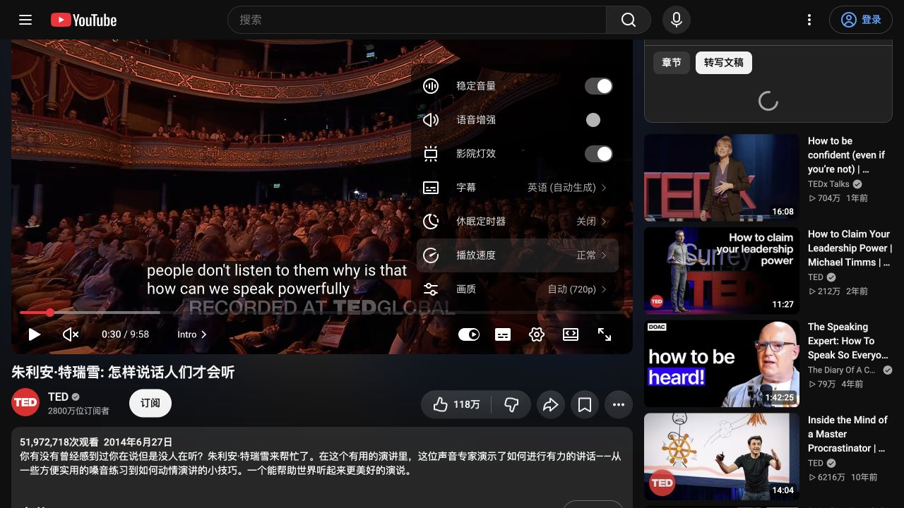

# YouTube 双语字幕可行性验证

> 历史研究记录：当前决策和后续真实验证见 [实现契约](../LEARN_IMPLEMENTATION.md) 及 [审核记录](LEARN-review-log.md)。保留本轮失败结果，不把旧候选状态当作当前结论。

- 日期：2026-11-03
- 状态：首轮实站与模型计时完成；字幕前瞻获取未通过，不能宣称端到端功能可行或已实现。
- 结果：[原始记录](youtube-feasibility-results.json)；探针：[字幕请求](youtube-caption-probe.py)、[真实模型计时](youtube-translation-probe.ts)。
- 本次未修改生产代码、安装到个人浏览器或读取浏览器登录凭证。
- 后续研究：[获取与替换显示选型](YOUTUBE-acquisition-rendering.md)，补充播放器响应复用、局部隐藏及恢复方案；属于文档／源码研究，不改变本报告“未来字幕尚未获取成功”的实测状态。

## 1 结论

需要把“看得到字幕”“拿得到后续时间轴”“模型翻译足够快”分开判断。本轮第一项观察到成功，第二项尚未成功，第三项在小规模自制字幕夹具上取得积极结果。当前不能把公式和模型速度结果当作完整双语字幕已经验证。

| 验证项 | 实际结果 | 含义 |
| --- | --- | --- |
| 普通观看页面 | 两个公开视频在未登录状态可打开、播放并显示字幕 | 当前环境可观看，不要求视频编辑权限 |
| 人工／自动字幕 | 第一份视频实际切换英语人工与自动生成轨，均显示文字 | 当前字幕的 DOM 读取可行，不等于可读取未来字幕 |
| 标准 TextTrack | 第一份视频在 30.290 秒处，video.textTracks 为空 | 不能依赖标准 TextTrack.cues 直接获取完整时间轴 |
| 文字稿面板 | 两份视频点击“内容转文字”后均持续显示 loading | 本轮未能通过该 UI 获取未来文本；不能断言原因或普遍不可用 |
| 页面轨信息 | 独立公开 HTTP 请求分别发现 49／50 条字幕轨 | 能识别源轨及人工／自动类别，不代表正文可下载 |
| 字幕正文 | 最终对照 8 次请求均 HTTP 200、0 字节 | 不能把 200 当成功，也不能把空正文当作视频无字幕 |
| 模型批次速度 | 两个已有模型各 3 次请求，完整返回 2.278～4.652 秒 | 支持继续研究提前翻译；不是真实视频链路和持续播放验收 |

## 2 实站范围和观测方式

使用应用内浏览器，通过普通播放器与文字稿 UI 观察；未登录账号，无验证码处理、cookie 导出或第三方字幕代理。样例：

- [Julian Treasure / TED](https://www.youtube.com/watch?v=eIho2S0ZahI)，播放器约 9:58；人工英语与自动生成英语轨实际切换并显示。
- [Tim Urban / TED](https://www.youtube.com/watch?v=arj7oStGLkU)，播放器约 14:03；实际显示英语字幕并打开文字稿面板。

第一份视频暂停时读取 DOM 媒体状态：currentTime=30.290238、duration=598.061、playbackRate=1、paused=true、textTracks=[]。这只是原生播放器状态证据，没有 Sayvia 覆盖层，也没有测量 Sayvia 的字幕同步误差。



随后使用独立 HTTP 客户端读取同两个公开页面，解析其字幕轨信息，并请求公开页面所提供的英语人工／自动字幕链接。只保留自己这次请求产生的匿名 cookie，不接触个人浏览器会话。

首轮对第一份视频请求 json3 格式的人工／自动字幕，均得到空正文。最终对照增加原样字幕 URL，排除仅由修改 fmt 参数导致失败的可能：两个视频 × 两种字幕轨 × 两种 URL 形式 = 8 次，均为空。最终 watch 页面耗时、字幕响应耗时及大小保存在 JSON；没有记录签名 URL、令牌、cookie 或整页 HTML。计入首轮共发起 10 次字幕正文请求，没有无界重试。

这是独立 HTTP 路径的失败记录，并未验证“在实际播放器当前会话中读取其正常字幕响应”是否可行。不能据此确定是网络、客户端上下文、服务端策略或其他原因；也不能推断任意其他视频都会失败。

## 3 真实模型速度验证

使用项目现有本机凭证，仅发送自制英文字幕短句。每个模型测试 5／10／20 行，按每行 3 秒构造 15／30／60 秒时间窗，分别为 39／84／169 个英文单词。时间窗是明确标注的夹具假设，不是从实际视频测得；实际字幕可能更密集、更碎或含重叠修订。

调用当前 `translate()`（算法 segments-v2.4），输入为按字幕行分隔的 plain-text，目标 zh-CN；记录从函数调用到完整结果校验返回的时间。首段临时译文也记录，但不拿它代替字幕可用时间。只调用 6 次，每样例每模型一次，无自动重试或选择性剔除。全部通过现有格式校验且输出行数一致；人工语义评审未完成。

| 模型 | 15 秒夹具／5 行 | 30 秒夹具／10 行 | 60 秒夹具／20 行 |
| --- | --- | --- | --- |
| gpt-6-luna | 3.429 秒 | 3.711 秒 | 4.652 秒 |
| deepseek-flash | 3.177 秒 | 2.278 秒 | 3.419 秒 |

例如 30 秒视频在 2 倍速下消耗 15 秒，两个模型本次完成该批次分别用 3.711／2.278 秒，剩余约 11.289／12.722 秒预算。60 秒夹具在 2 倍速下仍有约 25～27 秒余量。因此“先缓冲、再提前翻译下一批”的调度方向有依据；首次启动和跳到缓存外仍需等待。

六次请求合计 5,669 个服务商报告 token。报告保留自制源文、译文、用量、首预览和完整返回时间，可独立复核。既没有获得本次 YouTube 全量字幕，也没有将视频全量文本发给模型。

不从这 6 个点推断 P95、稳定成功率或任意视频 2 倍速保证。计时不包含字幕获取、扩展消息、覆盖层渲染和后台恢复；未测连续长视频、跳转优先级、翻译与查词竞争、限流以及网络抖动。每个模型的第一笔也不代表严格控制过的服务端冷启动。

## 4 修正后的实现方向

1. 保留按播放位置分批预取，30～60 秒作为下一轮候选缓存窗口；先有真实 cue，再讨论同步保证。
2. 放弃“从页面抄出链接后独立下载一定成功”的假设。下一轮验证随播放器正常获取字幕时，是否能在页面上下文捕获完整响应并有界缓存；仅捕获当前视频、当前轨的字幕数据，不收集其他网络内容。
3. 这需要专用最小原型验证 MAIN world 与隔离内容脚本之间的数据桥接。Chrome 提供脚本执行上下文选择，但这只证明有注入机制，不能证明 YouTube 响应一定可读。[Chrome scripting](https://developer.chrome.com/docs/extensions/reference/api/scripting)
4. 不把新增 webRequest 权限当作响应正文获取方案。Chrome 的该接口以请求生命周期、请求数据及响应头事件为主，不能凭看到请求就宣称取得字幕正文。[Chrome webRequest](https://developer.chrome.com/docs/extensions/reference/api/webRequest)
5. 若仅能取得正在显示的一句话，提供的只能是存在模型延迟的即时翻译，不能冒充“同步双语字幕”。本轮不静默降低用户需求。

下一原型的通过条件：实际人工与自动轨取得带起止时间的未来 cue；当前观看页和新导航都能启用；切轨／换视频能失效旧数据；获取不到时明确报错；再将这些真实 cue 接入真实模型并验证暂停、跳转、倍速和全屏。通过前 L00b 仍未完成，不将 L03／L04 记为可交付。

## 5 复现与检查

```sh
python3 docs/validation/youtube-caption-probe.py eIho2S0ZahI
python3 docs/validation/youtube-caption-probe.py arj7oStGLkU
pnpm exec tsx docs/validation/youtube-translation-probe.ts /tmp/NEW_YOUTUBE_TIMING.json
```

模型探针只读取 `.env.local` 的两项已用服务凭证，不输出秘密，结果写入新文件并检查凭证不在报告中；需真实网络，最多 6 次付费调用。重复执行会再次计费。字幕探针只输出元数据，未来成功时正文暂存于 `/tmp`，不自动放入报告。

检查范围：探针语法／定向 lint、文档链接、结果与结论一致性、diff 空白检查。未改生产实现，因此不把现有系统测试作为这项功能的完成证据。
